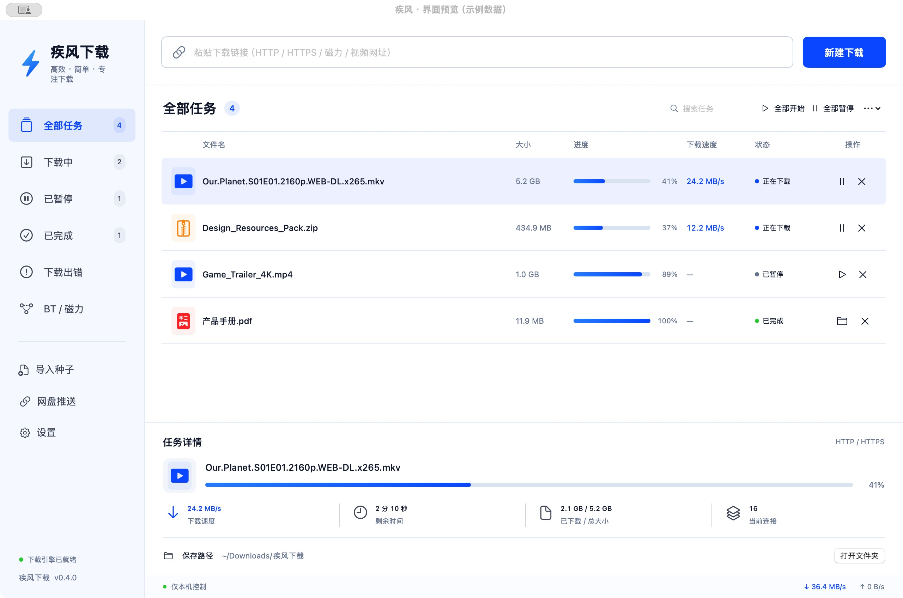

# Surge Download · 疾风下载

**A lightweight native macOS download manager.** Manage direct links, magnets, torrents and video downloads in one window.

[简体中文](README.md) · **English**

   

> Early-stage demo. The app does not impose a download speed cap. Actual throughput depends on the server, account permissions, network and BT peers. It does not replace a cloud-storage subscription or guarantee higher server-side limits.

## Download

### [⬇ Download v0.4.0 for Mac Apple Silicon (ZIP, ~121 MiB)](https://github.com/zhengkai400/surge-download/releases/download/v0.4.0/SurgeDownload-v0.4.0-macOS-arm64.zip)

[Release notes, checksums and corresponding sources](https://github.com/zhengkai400/surge-download/releases/tag/v0.4.0)

Requires **Apple Silicon (M-series) and macOS 15+**. Download the ZIP, unzip it and drag `疾风下载.app` to Applications. This is an early, non-notarized preview, not an Intel or Windows build. Follow the normal macOS first-launch confirmation flow. GitHub's automatically generated `Source code` archives are not runnable apps.

## Interface



*Captured from an isolated preview of the real application UI. Filenames, speeds and progress are sample data, not benchmark results. No personal download history or login information is shown. The application UI is currently Chinese; documentation is bilingual.*

- **Sidebar:** all tasks, downloading, paused, completed, errors and BT / magnets.
- **Link bar:** paste a URL and open the new-download dialog to confirm options.
- **Task table:** size, progress, current speed, status, pause / resume and removal.
- **Details panel:** select a task to see remaining time, downloaded size, current connections and save location; reveal files in Finder.
- **More menu:** clear completed records without deleting files.

## Features

| Feature | Current implementation |
| --- | --- |
| HTTP / HTTPS | Multi-connection segmented downloads through aria2; up to 8 connections per task by default, depending on server support. More connections do not imply proportional speed gains. |
| BT / magnets | Import `.torrent` files or magnet links. libtorrent handles metadata, DHT / trackers and peer connections. BT v1 and hybrid torrents are supported. |
| Task management | Search, filters, pause / resume, start / pause all, clear completed records, persistent history and partial downloads. |
| Video pages | yt-dlp processes individual video pages. YouTube, Bilibili, Xiaohongshu and Douyin URLs are recognized; other supported sites can use the video-page toggle. URL recognition is not a guarantee of successful extraction. |
| Quality preference | Best / 4K / 1080p / 720p / 480p preferences with fallback to available formats. FFmpeg merges separate streams, using MKV when needed. |
| Audio | Extract audio to MP3 using FFmpeg. |
| Cloud-storage push | Accept HTTP tasks from LinkSwift through a local Aria2-compatible endpoint. Cookie-bearing requests are currently restricted to Quark HTTPS domains. |
| Folder push (experimental) | Included LinkSwift adaptation recursively expands Quark folders while preserving relative paths. Live API compatibility needs further testing. |
| Settings | Change the save location for new tasks; choose BT upload caps of 256 KB/s, 1 MB/s, 5 MB/s or unlimited. |

### Known limitations

- **Douyin extraction is not fixed:** local tests returned HTTP 403. A community `a_bogus` patch did not fix the tested URL and is not included in production. Successful browser playback after dismissing a login prompt does not guarantee that yt-dlp's API request succeeds.
- **Site compatibility changes:** some Xiaohongshu and YouTube links have passed live download tests, but this is not a site-wide guarantee. HTTP 403, expired signatures, region and account restrictions may still occur. Re-extraction can help with some failures but is not guaranteed to work.
- No automatic browser-cookie import, playlist batches, subtitle selection or video thumbnail preview.
- Pure BT v2 is not supported. Magnets without available peers may remain at metadata discovery; an original torrent file can be imported instead.
- Video jobs use a separate queue with up to two concurrent jobs, independent of aria2's normal task concurrency.
- Multi-account merging and cross-account speed experiments are **not shipped features**.
- Apple Silicon only; no Intel, Windows or Linux build. The app is not Apple-notarized.

## Usage

### Launch

Download the application ZIP above, unzip it and open `疾风下载.app`, or build from source. Quit the old version before upgrading; do not run multiple instances. Existing task data is retained.

### Direct links and torrents

1. Paste a link into the top bar and click **新建下载** (New download, `⌘N`). The dialog accepts one link per line.
2. Review the save location, then click **开始下载** (Start download).
3. Use **导入种子** (Import torrent) in the sidebar or File menu for torrent files.
4. Select a row to inspect its details. Row buttons and the context menu provide pause / resume, Finder reveal and record removal.

### Change the download location

Use **设置 → 保存目录 → 更改…** (Settings → Save directory → Change), or change it in the new-download dialog. Only new tasks use the new location; existing files are not moved. BT and video tasks use individual subdirectories.

### Video and audio

1. Paste a specific video-page URL. A single HTTP link can also be extracted from shared text.
2. Recognized sites automatically use video extraction. For other sites, enable **按视频网页解析** (Parse as video page).
3. Choose a preferred quality or enable **仅音频 · MP3** (Audio only).
4. Wait for stream downloads and merging. Progress may change when switching between video and audio tracks or entering the merge phase.

### LinkSwift integration

1. Install [LinkSwift](https://github.com/hmjz100/LinkSwift) in your browser and sign into your cloud-storage account there.
2. Open **网盘推送** (Cloud-storage push) in Surge Download and enable incoming tasks.
3. Copy the displayed host, port, path and dedicated secret into LinkSwift's **Aria2 server settings**. Leave its storage-path field empty; Surge controls the directory.
4. Test the connection, select files and push via Aria2.
5. For experimental folder handling, read the [folder adapter notes](userscript/README.md) and start with a small folder.

### Clear completed records

Use the top-right **⋯ → 一键清除已完成记录**. Files remain on disk. Removing a single task also preserves its downloaded files.

## Network behavior and privacy

- Control APIs bind only to loopback. The main engine uses a random port and secret. External push is disabled by default, with a separate secret and origin / method restrictions.
- The HTTP engine does not explicitly configure an external proxy, but system VPN / TUN routing may still affect its traffic. Video extraction may use system proxy settings.
- BT peer connections use the configured system SOCKS5 proxy when available. **DHT discovery remains direct and exposes the local network's public IP.** This is not an anonymity tool.
- BT downloads upload to peers, with a default total upload cap of 1 MB/s. Seeding stops after completion.
- Local settings, history and sessions are stored under `~/Library/Application Support/SurgeDownload`, with restricted directory / sensitive-file permissions. Sessions may contain cookies and signed URLs.
- Never publish that runtime directory, cookies, signed URLs or RPC secrets. Sanitize diagnostic logs before sharing them.
- No clipboard scanning, login items or automatic execution of downloaded files.
- Download only content you are entitled to access and save, and follow the relevant service terms.

## Build from source

Requires macOS 15+, Apple Silicon, Xcode Command Line Tools, Homebrew, Python 3.13, aria2, FFmpeg and Node.js. The current bundler expects the Apple Silicon Homebrew layout under `/opt/homebrew`.

```bash
xcode-select --install   # Skip if already installed
brew install python@3.13 aria2 ffmpeg node@24
git clone https://github.com/zhengkai400/surge-download.git
cd surge-download
/opt/homebrew/bin/python3.13 -m venv .venv
.venv/bin/python -m pip install -r backend/requirements-build.txt
export NODE_BINARY="$(brew --prefix node@24)/bin/node"
./build.sh
open build/疾风下载.app
```

`NODE_BINARY` selects a local Node executable; otherwise the bundler checks PATH and `/usr/local/bin/node`. The build bundles dependencies and applies an ad-hoc signature, not Apple notarization. Review the source and origin and use the normal macOS confirmation interface when prompted; disabling system security is not required.

### Local tests

```bash
.venv/bin/python tests/bridge_integration.py
.venv/bin/python tests/linkswift_integration.py
.venv/bin/python tests/video_integration.py
.venv/bin/python tests/video_redirects.py
.venv/bin/python tests/folder_paths.py
node --test tests/folder.test.cjs
```

Tests cover local HTTP / BT integration, push boundaries, video and MP3 output, pause / resume and persistent records. Third-party sites require separate live validation.

## Layout

```text
Sources/            SwiftUI UI, task management and local RPC client
backend/            BT / HTTP bridge, LinkSwift receiver and video workers
userscript/         Experimental folder adapter and original license
tests/              Local integration, path and input tests
docs/images/        Privacy-safe application screenshots
build.sh            macOS application build
bundle_*.py / .sh    Engine, dependency and license bundlers
```

## License and credits

Original project code is licensed under **AGPL-3.0-or-later**; see [LICENSE](LICENSE). Third-party code retains its own terms and attribution; see [THIRD_PARTY_NOTICES.md](THIRD_PARTY_NOTICES.md).

Thanks to [aria2](https://github.com/aria2/aria2), [libtorrent](https://github.com/arvidn/libtorrent), [yt-dlp](https://github.com/yt-dlp/yt-dlp), [FFmpeg](https://ffmpeg.org/) and [LinkSwift](https://github.com/hmjz100/LinkSwift). Before redistributing bundled binaries, independently satisfy all applicable license and corresponding-source requirements. Application and dependency sources with build recipes are provided in the `Corresponding-Sources` release asset.
